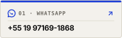
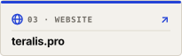

# Murilo Fornel de Almeida
### Full Stack Software Engineer &bull; Founder at [Teralis Tecnologia](https://teralis.pro)

 

<!-- Canais Oficiais de Contato & Redes Sociais -->

  

<!-- Spotify Embed: From the Start - Good Kid -->

  

 

  

 

Murilo Fornel de Almeida &bull; Amparo, SP &bull; 🇧🇷 Brasil &bull; Atuação Remota Global

