<p align="center">
  
</p>

<p align="center">
  <a href="https://teralis.pro">
    
  </a>
  <a href="https://www.linkedin.com/in/murilo-fornel-de-almeida/">
    
  </a>
  <a href="https://wa.me/5519971691868">
    
  </a>
  <a href="mailto:murilofdal@gmail.com">
    
  </a>
</p>

> [!NOTE]
> **Engineering Statement**  
> Full Stack Engineer & Software Architect focused on crafting resilient multi-tenant SaaS platforms, high-throughput asynchronous automations, and pixel-precise, conversion-driven web applications. Operating end-to-end: from domain modeling and relational database schemas to fluid client interfaces.

---

### 📦 Featured Architectures & Production Systems

<table>
  <tr>
    <td width="50%" valign="top">
      <h3>🏢 <a href="https://teralis.pro">Teralis Imob</a></h3>
      <p><b>Multi-Tenant Real Estate & CRM Ecosystem</b></p>
      <p>Proprietary infrastructure engineered for sub-second photo delivery on mobile networks. Features strict tenant data isolation, granular role-based permissions, and automated lead routing straight to broker WhatsApp with 1 click.</p>
      <p>
        <code>Next.js 15</code> <code>NestJS</code> <code>TypeScript</code> <code>Supabase</code> <code>Tailwind</code>
      </p>
    </td>
    <td width="50%" valign="top">
      <h3>🚛 <b>TransportAI</b></h3>
      <p><b>Real-Time Logistics & Fleet Management</b></p>
      <p>Corporate full-stack operations platform for freight carriers. Dynamic pricing and toll calculation engine, route optimization, asynchronous webhook pipelines, and live driver/load tracking dashboard.</p>
      <p>
        <code>Next.js 15</code> <code>Node.js</code> <code>PostgreSQL</code> <code>Docker</code> <code>REST APIs</code>
      </p>
    </td>
  </tr>
  <tr>
    <td width="50%" valign="top">
      <h3>⚖️ <b>Grupo Discovery</b></h3>
      <p><b>Legal Case Pipeline & Interactive Genealogical Graph</b></p>
      <p>Full-stack process management platform designed for international citizenship consultancies. Includes interactive family tree graph visualization, document validation workflows, and financial installment tracking.</p>
      <p>
        <code>React</code> <code>TypeScript</code> <code>PostgreSQL</code> <code>Prisma</code> <code>Tailwind</code>
      </p>
    </td>
    <td width="50%" valign="top">
      <h3>🏭 <a href="https://github.com/fornel07/pmtlog">PMT Log</a></h3>
      <p><b>Industrial Storage & High-End 3D Web Experience</b></p>
      <p>High-performance digital presence with interactive 3D product simulation, dynamic cost estimation forms, custom dark/light theme switching, and top Core Web Vitals speed scores.</p>
      <p>
        <code>Next.js</code> <code>Three.js</code> <code>GSAP</code> <code>Framer Motion</code> <code>Tailwind</code>
      </p>
    </td>
  </tr>
</table>

---

### ⚡ Engineering Guidelines & Standards

```typescript
// murilo.config.ts
export const engineeringProfile = {
  name: "Murilo Fornel de Almeida",
  role: "Full Stack Engineer & Software Architect",
  company: "Teralis Tecnologia",
  location: "Amparo, SP — Brazil",
  philosophy: [
    "Clean Architecture & Domain-Driven Design (DDD)",
    "Strict type safety end-to-end (TypeScript / NestJS)",
    "Zero AI slop: functional, robust, and tested production code",
    "High conversion UI/UX with instant sub-second page loads"
  ],
  stack: {
    frontend: ["Next.js 15", "React 19", "TypeScript", "Tailwind CSS", "HeroUI", "GSAP", "Three.js"],
    backend: ["Node.js", "NestJS", "PHP", "Laravel", "RESTful APIs", "Webhooks", "MCP"],
    database: ["PostgreSQL", "MySQL", "Redis", "Prisma ORM", "Supabase"],
    devops: ["Docker", "Linux", "Git / GitHub Actions", "Vercel", "Figma", "Spline"]
  }
} as const;
```

---

> [!TIP]
> **Need a bespoke software solution?**  
> I design and engineer custom SaaS architectures, operational dashboards, and API automations from scratch. Reach out via [WhatsApp (+55 19 97169-1868)](https://wa.me/5519971691868) or email [murilofdal@gmail.com](mailto:murilofdal@gmail.com) to discuss your project scope.

<br />

<p align="center">
  <sub>© 2026 Murilo Fornel de Almeida • Built with Prose UI aesthetic standards</sub>
</p>
